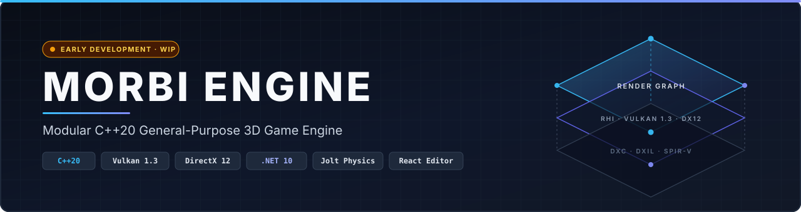
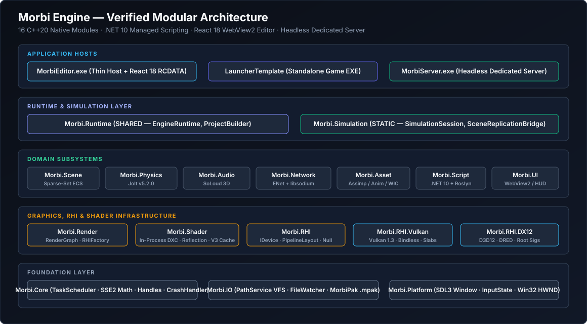
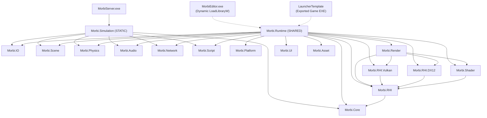
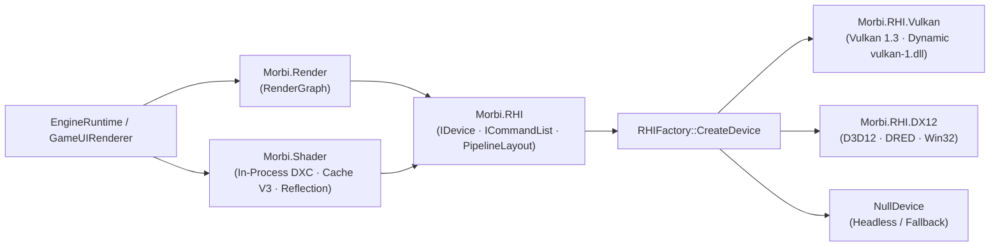
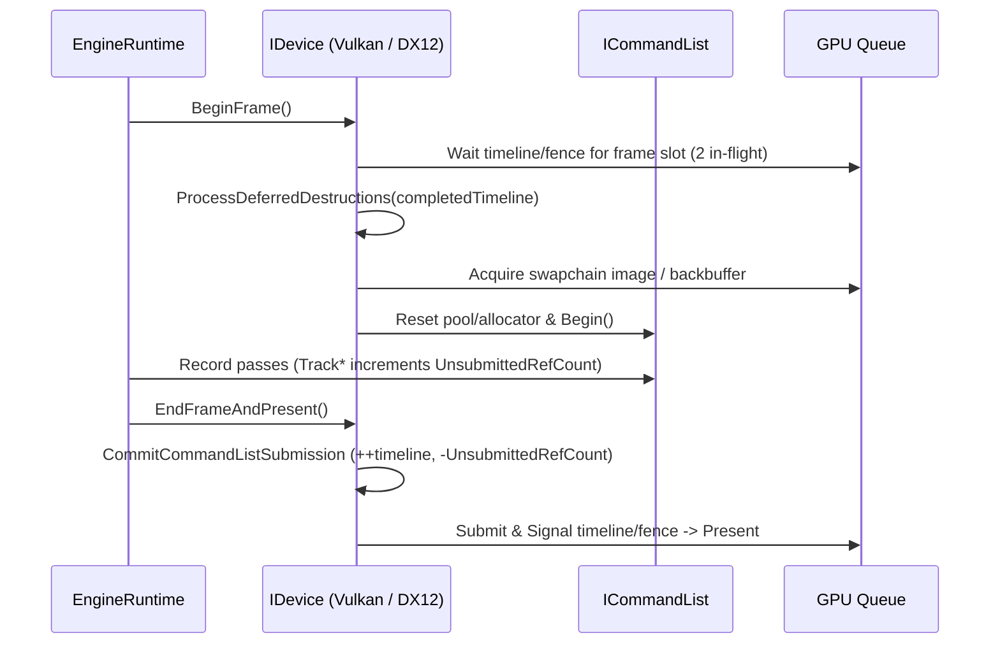
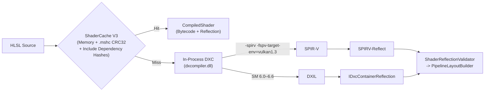
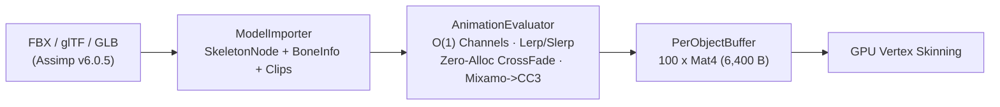
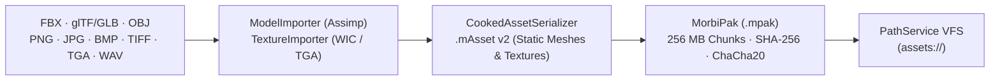

<p align="center">
  
</p>

<p align="center">
  
  
  
  
  
  
  
  
</p>

<p align="center">
  <strong>A modular, general-purpose C++20 3D game engine featuring dual Vulkan 1.3 &amp; DirectX 12 backends, an in-process DXC shader pipeline, Sparse-Set SoA ECS, Jolt Physics, authenticated multiplayer networking, .NET 10 Roslyn scripting, and a React 18 WebView2 editor.</strong>
</p>

<p align="center">
  <a href="#overview">Overview</a> ·
  <a href="#development-status">Status</a> ·
  <a href="#features">Features</a> ·
  <a href="#architecture">Architecture</a> ·
  <a href="#graphics-architecture">Graphics</a> ·
  <a href="#build-instructions">Build</a> ·
  <a href="#roadmap">Roadmap</a> ·
  <a href="#documentation">Docs</a>
</p>

---

> ### ⚠️ Active Development — Early Development Stage
>
> **Morbi Engine is currently under active development.** Its architecture, rendering systems, editor, runtime, and supporting subsystems are continuously evolving.
>
> The engine is **not yet production-ready, stable, or feature-complete**. Public APIs, internal module boundaries, build requirements, asset formats, and workflows may change without notice, and backward compatibility is not guaranteed during early development. Build stability, graphics backend parity, and cross-platform compatibility are still being improved.
>
> This repository represents ongoing engineering work and documents the transparent evolution of the project.

---

## Table of Contents

- [Overview](#overview)
- [Development Status & API Disclaimer](#development-status)
- [Feature Maturity Matrix](#features)
- [Architecture](#architecture)
- [Graphics Architecture](#graphics-architecture)
- [Rendering Pipeline](#rendering)
- [Animation System](#animation)
- [Asset Pipeline](#asset-pipeline)
- [Editor & Runtime](#editor)
- [Technology Stack](#technology-stack)
- [Repository Structure](#repository-structure)
- [Requirements](#requirements)
- [Build Instructions](#build-instructions)
- [Platform Support](#platform-support)
- [Roadmap](#roadmap)
- [Documentation](#documentation)
- [Contributing, Security & License](#contributing)

---

## <a id="overview"></a>Overview

**Morbi Engine** is a general-purpose, modular C++20 3D game engine built around clean subsystem boundaries, explicit GPU resource lifetime management, and modern developer tooling.

Its long-term engineering direction targets:
- **General-purpose 3D game development** (RPG, FPS, multiplayer, simulation, and interactive 3D applications).
- **Explicit multi-API graphics infrastructure** (Vulkan 1.3 & DirectX 12 behind a common RHI and dual-target DXC shader pipeline).
- **Data-oriented runtime performance** (paged Sparse-Set SoA ECS with zero-copy `Span<T>` interop into `.NET 10` C# gameplay scripts).
- **Separation of simulation and presentation** (a headless `Morbi.Simulation` static library powering `MorbiServer.exe` with zero graphics or windowing dependencies).
- **Modern editor tooling** (a thin native Win32 host embedding a React 18 + TypeScript + Tailwind CSS UI over Edge WebView2).

---

## <a id="development-status"></a>Development Status & API Disclaimer

During this early development stage:
- **Public and internal APIs may change** as subsystems mature (particularly RHI pipeline state, RenderGraph scheduling, and `.mAsset` serialization).
- **Asset formats and scene schemas may evolve** without automated migration guarantees.
- **Build and dependency requirements may change** as remaining third-party libraries are migrated to self-contained CMake packages.
- **Platform support is currently Windows x64 (MSVC) only**; Linux and macOS are not yet build-verified.
- **Implemented ≠ Production-Ready:** In the matrices below, *Implemented* indicates that working code exists in the repository—not that the subsystem is feature-complete or hardened for shipping titles.

---

## <a id="features"></a>Feature Maturity Matrix

Status legend: **Implemented** (exists in codebase) · **In Progress** (actively evolving) · **Experimental** (early/partial behavior) · **Planned** (future roadmap).

| System | Subsystem / Capability | Status | Verified Notes |
|---|---|---|---|
| **Core** | Modular C++20 Architecture (`Morbi.Core`) | **Implemented** | Logging, `Result<T,E>`, SSE2 math, work-stealing `TaskScheduler`, `GenerationalPool`, SEH/VEH `CrashHandler` |
| **IO / VFS** | Virtual Filesystem & `MorbiPak` (`.mpak`) | **Implemented** | `PathService`, Win32 `FileWatcher`, chunked 256 MB `.mpak` with SHA-256 & optional `ChaCha20Sha256` (no compression yet) |
| **Platform** | SDL3 Window & Input (`Morbi.Platform`) | **Implemented** | SDL3 windowing, DPI scale, 512-key `InputState`, Win32 `HWND` extraction |
| **ECS** | Paged Sparse-Set SoA ECS (`Morbi.Scene`) | **Implemented** | 11 components (9 blittable POD), hierarchy, JSON scenes, PIE snapshot/restore |
| **Graphics** | RHI & `PipelineLayoutValidator` (`Morbi.RHI`) | **Implemented** | Generational handles, DX12/Vulkan layout validation, `NullDevice`; narrow PSO state surface & no `BindDescriptorSet` yet |
| **Graphics** | Vulkan 1.3 Backend (`Morbi.RHI.Vulkan`) | **Implemented** | Dynamic `vulkan-1.dll` dispatch, Dynamic Rendering, timeline semaphores, custom 32 MB slab allocator, bindless Set 0 |
| **Graphics** | DirectX 12 Backend (`Morbi.RHI.DX12`) | **Implemented** | Standard Windows SDK D3D12, DRED breadcrumbs/page-faults, bindless SRV heap, Root Signatures; partial parity with Vulkan |
| **Graphics** | GPU Resource Lifetime & Deferred Destruction | **Implemented** | `UnsubmittedRefCount` tracking + monotonic timeline/fence deferred reclamation (2 frames in flight) |
| **Shaders** | In-Process DXC, Cache V3 & Reflection (`Morbi.Shader`) | **Implemented** | Dual-target DXIL + SPIR-V, CRC32 `.mshc` disk cache with include hashing, `SPIRV-Reflect` + DXIL reflection, `PipelineLayoutBuilder` |
| **Rendering** | Render Graph (`Morbi.Render`) | **In Progress** | Linear pass execution, sequential barriers, name-based texture pooling; no DAG sort/culling or physical memory aliasing yet |
| **Rendering** | Forward Mesh & GPU Skinning | **Implemented** | Indexed multi-submesh rendering, `D32_Float` depth, bindless textures, 100-bone GPU skinning, wireframe physics debug |
| **Rendering** | PBR Materials, Scene Lighting & Post-Processing | **Experimental** | Currently hardcoded Blinn-Phong with 2 fixed lights (`LightComponent` unused); GBuffer/Shadows/IBL/Post-FX are placeholder stubs |
| **Animation** | Skeletal Animation (`Morbi.Asset`) | **Implemented** | Forward kinematics, zero-alloc CrossFade, sockets, Mixamo→CC3 retargeting, C# `Animator` API; state machines/IK planned |
| **Physics** | Jolt Physics v5.2.0 (`Morbi.Physics`) | **Implemented** | Rigid bodies, compound colliders, ray/shape casts, 4 joint types, `CharacterVirtual`, C# bindings; mesh/convex colliders planned |
| **Audio** | SoLoud 3D Audio (`Morbi.Audio`) | **Implemented** | Miniaudio + null driver, 2D/3D spatial playback, procedural WAV; streaming/buses planned |
| **Assets** | Import & `.mAsset` Cooking (`Morbi.Asset`) | **In Progress** | Assimp v6.0.5 (FBX/glTF/GLB/OBJ), WIC/TGA textures, `.mAsset` v2 static meshes/textures; skeleton/clip cooking planned |
| **Networking** | ENet + libsodium & Dedicated Server (`Morbi.Network`) | **Implemented** | X25519/Ed25519/XChaCha20-Poly1305 AEAD, delta/keyframe replication, interest management, RPCs, headless `MorbiServer.exe` |
| **Scripting** | `.NET 10` CoreCLR + Roslyn (`Morbi.Script`) | **Implemented** | `hostfxr`, in-process Roslyn compilation, `CollectibleScriptLoadContext` hot-reload, zero-copy `Span<T>` ECS arenas |
| **Editor & UI** | React 18 WebView2 Editor & Procedural HUD (`Editor`, `Morbi.UI`) | **In Progress** | Embedded singlefile React 18 UI (`SetWindowRgn` viewport hole + JSON WebMessages), procedural SDF HUD/2D Gizmo; `BinaryIPCBridge` partially wired |

---

## <a id="architecture"></a>Architecture

Morbi Engine separates engine concerns into **16 native C++20 libraries**, a **`.NET 10` managed runtime bridge**, and three application hosts (`MorbiEditor.exe`, `LauncherTemplate`, and headless `MorbiServer.exe`).

<p align="center">
  
</p>

### Verified Module Dependency Graph



> Deep dives: [`docs/architecture/OVERVIEW.md`](docs/architecture/OVERVIEW.md) · [`docs/architecture/ENGINE_CORE.md`](docs/architecture/ENGINE_CORE.md)

---

## <a id="graphics-architecture"></a>Graphics Architecture

Morbi Engine's graphics stack is split across `Morbi.RHI`, `Morbi.RHI.Vulkan`, `Morbi.RHI.DX12`, `Morbi.Shader`, and `Morbi.Render`.

### 1. RHI & Dual-Backend Dispatch



### 2. Vulkan 1.3 vs. DirectX 12 — Honest Parity Comparison

| Capability | Vulkan 1.3 (`RHI.Vulkan`) | DirectX 12 (`RHI.DX12`) |
|---|---|---|
| Dynamic Rendering / Targets | Vulkan 1.3 `vkCmdBeginRendering` | Legacy `OMSetRenderTargets` + `Clear*View` |
| Memory Allocation | Custom 32 MB slab sub-allocator | `CreateCommittedResource` per resource |
| Bindless SRVs | Set 0 (`4096` Buffers + `4096` Textures) | Shader-visible heap (`4096` + `4096`) |
| `BindConstantBuffer` | Mutates Set 0 binding 3 (ignores slot) | Per-draw `SetGraphicsRootConstantBufferView` |
| Custom `PipelineLayout` | Cached `VkPipelineLayout` + descriptor sets | Cached serialized `ID3D12RootSignature` |
| Deferred Destruction | Timeline semaphore + `UnsubmittedRefCount` | `ID3D12Fence` + `UnsubmittedRefCount` |
| Debug Markers & Forensics | `VK_EXT_debug_utils` labels & validation | No-op markers; **DRED** breadcrumbs & page-fault dumps |

### 3. Frame Execution, Synchronization & Deferred Destruction



### 4. In-Process DXC Dual-Target Shader Pipeline (`Morbi.Shader`)



> Deep dives: [`GRAPHICS_ARCHITECTURE.md`](docs/architecture/GRAPHICS_ARCHITECTURE.md) · [`GPU_RESOURCE_LIFETIME.md`](docs/architecture/GPU_RESOURCE_LIFETIME.md) · [`SHADER_PIPELINE.md`](docs/architecture/SHADER_PIPELINE.md)

---

## <a id="rendering"></a>Rendering Pipeline

`RenderGraph` (`Morbi.Render`) executes registered passes linearly, synthesizes sequential resource barriers, and pools transient textures by name/descriptor across frames. Currently, `GBufferPass`, `LightingReadPass`, and `PostProcessWritePass` are placeholder stubs while `GameUI_HUD_Pass` and `FinalCompositePass` perform active rendering (sky/infinite ground grid, forward static & 100-bone skinned meshes, wireframe physics debug colliders, and the procedural SDF HUD/2D gizmo overlay).

> Full details & known gaps: [`docs/architecture/RENDER_PIPELINE.md`](docs/architecture/RENDER_PIPELINE.md)

---

## <a id="animation"></a>Animation System



Controlled from C++ (`Scene::AnimatorComponent`) and C# (`Managed/Morbi.Engine/Animator.cs`: `Play`, `Pause`, `Stop`, `CrossFade`, `PlaybackSpeed`). State machines, blend trees, and IK are planned.

> Full details: [`docs/architecture/ANIMATION_SYSTEM.md`](docs/architecture/ANIMATION_SYSTEM.md)

---

## <a id="asset-pipeline"></a>Asset Pipeline



> Full details: [`docs/architecture/ASSET_PIPELINE.md`](docs/architecture/ASSET_PIPELINE.md)

---

## <a id="editor"></a>Editor & Runtime

- **`MorbiEditor.exe`:** Thin Win32 host that embeds the single-file React 18 + TypeScript + Tailwind CSS bundle via `RCDATA` and dynamically loads `Morbi.Runtime.dll`. Uses Edge WebView2 with Win32 `SetWindowRgn` viewport hole-punching and JSON WebMessages (`BinaryIPCBridge` shared memory is partially wired).
- **`MorbiServer.exe`:** Headless dedicated server linking only `Morbi.Simulation` (multi-world `SimulationSession` + `SceneReplicationBridge` over ENet + libsodium).
- **`ProjectBuilder`:** Compiles C# scripts via Roslyn, packs `.mpak` archives, and compiles `LauncherTemplate` into standalone game executables.

> Full details: [`docs/architecture/EDITOR_ARCHITECTURE.md`](docs/architecture/EDITOR_ARCHITECTURE.md)

---

## <a id="technology-stack"></a>Technology Stack

| Category | Verified Technologies |
|---|---|
| **Languages** | C++20, C# (`.NET 10`), TypeScript 5.6, HLSL SM 6.x |
| **Build System** | CMake 3.24+ (`CMakePresets.json`), MSVC x64, Vite 5.4 (`vite-plugin-singlefile`), .NET SDK 10 |
| **Graphics & Shaders** | Vulkan 1.3 (dynamic `vulkan-1.dll`), DirectX 12 (`d3d12`/`dxgi`), In-Process DXC, Khronos `SPIRV-Reflect` |
| **Physics & Audio** | Jolt Physics v5.2.0, SoLoud 202002 (Miniaudio + null) |
| **Networking** | ENet v1.3.18, libsodium 1.0.20 (X25519, Ed25519, XChaCha20-Poly1305) |
| **Platform, Assets & UI** | SDL3 v3.2.0, Assimp v6.0.5, WIC + TGA, `nlohmann/json`, Edge WebView2, React 18, Tailwind CSS 3.4, Roslyn `5.12.0` |

---

## <a id="repository-structure"></a>Repository Structure

```text
MorbiEngine/
├── CMakeLists.txt             # Root CMake configuration
├── CMakePresets.json          # Windows x64 Release / Debug presets
├── cmake/                     # Compiler options & dependency resolution
├── Engine/Source/             # 16 modular C++20 engine libraries
├── Managed/Morbi.Engine/      # .NET 10 C# API, Roslyn compiler & Span<T> ECS bridge
├── Editor/                    # MorbiEditor thin host + React 18/TS/Vite frontend
├── Samples/                   # Sandbox sample project & PhysicsShowcase scripts
├── ThirdParty/                # Vendored JoltPhysics v5.2.0 & SPIRV-Reflect
├── Tests/                     # Existing automated CTest suites
└── docs/                      # Architecture, development guides, roadmap & ADRs
```

> Full breakdown: [`docs/development/PROJECT_STRUCTURE.md`](docs/development/PROJECT_STRUCTURE.md)

---

## <a id="requirements"></a>Requirements

- **OS:** Windows 10 / 11 x64 *(only verified build target)*
- **Compiler:** Visual Studio 2022 (MSVC v143+, C++20) & Windows 10/11 SDK
- **Build Tools:** CMake 3.24+, Node.js 18+/20+ & npm, `.NET 10` SDK (`Microsoft.NETCore.App.Host.win-x64`)
- **Graphics / Shaders:** Vulkan SDK (headers + DXC `dxc.exe`/`dxcompiler.dll`/`dxil.dll`) and a Vulkan 1.3 or DirectX 12 capable GPU
- **Optional Runtime DLLs:** `WebView2Loader.dll` (Editor UI), Assimp & SoLoud (optional features)

---

## <a id="build-instructions"></a>Build Instructions

```powershell
# 1. Clone the repository
git clone <repository-url>
cd MorbiEngine

# 2. Build the React 18 Editor Frontend (embedded into MorbiEditor.exe via RCDATA)
cd Editor\Frontend
npm install
npm run build
cd ..\..

# 3. Configure and build the C++20 Engine, .NET 10 Managed Bridge, Server & Editor
cmake --preset windows-release
cmake --build --preset release

# 4. Run the Editor or Headless Dedicated Server
.\build\bin\Release\MorbiEditor.exe
.\build\bin\Release\MorbiServer.exe
```

> Full options, DXC/WebView2 flags, and clean-clone dependency notes: [`docs/development/BUILDING.md`](docs/development/BUILDING.md)

---

## <a id="platform-support"></a>Platform Support

| Platform | Architecture | Build Status | Graphics Backends | Notes |
|---|---|---|---|---|
| **Windows 10 / 11** | x64 (MSVC) | **Build Verified** | Vulkan 1.3, DirectX 12, Null | Primary development target; Win32 WebView2, WIC, `FileWatcher`, `DbgHelp` |
| **Linux** | x64 | **Not Verified / Planned** | Vulkan 1.3 (planned) | `RHI.DX12` guarded on Win32; Win32 APIs in `UI`/`IO`/`Asset`/`RHI.Vulkan` need POSIX ports |
| **macOS** | arm64 / x64 | **Planned** | Metal (`BackendAPI::Metal` falls back to `NullDevice`) | No Metal backend implemented yet |

---

## <a id="roadmap"></a>Roadmap

The live engineering roadmap and Architecture Decision Records live in [`docs/road/MORBI_ENGINE_ROADMAP.md`](docs/road/MORBI_ENGINE_ROADMAP.md). No release dates or completion percentages are promised during early development.

- **Completed Milestones:** Modular 16-target C++20 architecture; Sparse-Set SoA ECS; Jolt Physics v5.2.0 integration; ENet + libsodium networking & `MorbiServer`; `.NET 10` Roslyn scripting; Vulkan 1.3 & DX12 RHI foundations with deferred destruction; In-process DXC dual-target compiler, ShaderCache V3, SPIRV-Reflect + DXIL reflection, and `PipelineLayoutValidator`.
- **In Progress:** Binding unified `PipelineLayout`s into active `EngineRuntime` passes; migrating remaining legacy third-party dependencies (`SoLoud`, `Assimp`, `DXC`, `WebView2Loader`) to self-contained CMake packages; breaking up monolithic `EngineRuntime.cpp`; real DAG RenderGraph scheduling & GPU memory aliasing.
- **Planned:** True PBR lighting wired to `LightComponent`, shadows, IBL, post-processing; skeletal animation cooking (`.mAsset`), state machines/blend trees, IK; convex/mesh physics colliders; `BindDescriptorSet` & configurable PSO state in RHI.
- **Long-Term Goals:** Cross-platform Linux/macOS support, full Vulkan/DX12 backend parity, mature editor tooling and packaging workflows.

---

## <a id="documentation"></a>Documentation

- [**Documentation Hub (`docs/README.md`)**](docs/README.md)
- **Architecture:** [Overview](docs/architecture/OVERVIEW.md) · [Engine Core](docs/architecture/ENGINE_CORE.md) · [Graphics & RHI](docs/architecture/GRAPHICS_ARCHITECTURE.md) · [Render Pipeline](docs/architecture/RENDER_PIPELINE.md) · [GPU Lifetime](docs/architecture/GPU_RESOURCE_LIFETIME.md) · [Shader Pipeline](docs/architecture/SHADER_PIPELINE.md) · [Animation](docs/architecture/ANIMATION_SYSTEM.md) · [Assets](docs/architecture/ASSET_PIPELINE.md) · [Physics & Audio](docs/architecture/PHYSICS_AND_AUDIO.md) · [Editor & Server](docs/architecture/EDITOR_ARCHITECTURE.md)
- **Development:** [Building](docs/development/BUILDING.md) · [Dependencies](docs/development/DEPENDENCIES.md) · [Project Structure](docs/development/PROJECT_STRUCTURE.md) · [Guidelines](docs/development/DEVELOPMENT_GUIDELINES.md)
- **Engineering Governance:** [Roadmap](docs/road/MORBI_ENGINE_ROADMAP.md) · [Status](docs/road/STATUS.md) · [ADRs](docs/road/decisions/README.md)

---

## <a id="contributing"></a>Contributing, Security & License

- **Contributing:** See [`CONTRIBUTING.md`](CONTRIBUTING.md) and [`CODE_OF_CONDUCT.md`](CODE_OF_CONDUCT.md).
- **Support:** See [`SUPPORT.md`](SUPPORT.md).
- **Security:** See [`SECURITY.md`](SECURITY.md) for private vulnerability reporting.
- **Third-Party Notices:** See [`docs/THIRD_PARTY_NOTICES.md`](docs/THIRD_PARTY_NOTICES.md) for the complete license terms of all third-party dependencies.

### License — Morbi Engine Source-Available License (MESAL) v1.0

Morbi Engine is licensed under the custom **[Morbi Engine Source-Available License (MESAL) v1.0](LICENSE)**.

> **Important:** MESAL v1.0 is a **source-available license** and is **NOT** an Open Source Initiative (OSI)-approved open-source license. This custom license draft requires review by qualified legal counsel before public release or commercial enforcement.

| Action | Status | Summary |
|---|---|---|
| Inspect & audit source code | **Permitted** | View and study the Morbi Engine source code. |
| Modify source code locally | **Permitted** | Make local/internal modifications for your own game development. |
| Build & ship free or commercial games | **Permitted** | Develop and distribute free or commercial Game Builds made with Morbi Engine. |
| Bundle required runtime binaries in a Game Build | **Permitted** | Distribute compiled Engine Runtime Components (DLLs, libraries, launcher/server binaries) **solely** as an integral part of your finished Game Build. |
| Redistribute Engine source, modified source, Editor, or SDK | **Prohibited** | You may not redistribute Engine source code, Modifications, `MorbiEditor`, development tools, SDKs, or standalone engine packages. |
| Redistribute dev tools or create a derivative engine | **Prohibited** | Game Build runtime permission does not allow standalone engine distribution, unrelated dev-tool redistribution, or building another engine/SDK product. |
| Morbi Engine trademarks & logos | **Not Granted** | No trademark or logo rights are transferred under MESAL v1.0. |
| Warranty & liability | **None (AS-IS)** | Provided "AS IS" without warranty or liability. |

Third-party libraries and toolchains remain governed exclusively by their own licenses; see [`docs/THIRD_PARTY_NOTICES.md`](docs/THIRD_PARTY_NOTICES.md).
