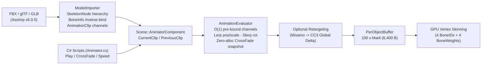

# Animation System (`Morbi.Asset` · `Morbi.Scene` · `Morbi.Script`)

**Status:** **Implemented** (forward kinematics, CrossFade blending, Mixamo-to-CC3 retargeting, 100-bone GPU skinning, C# API). State machines, blend trees, and IK are **Planned**.

---

## 1. Animation Pipeline

---

## 2. Verified Capabilities

- **Data Model (`Engine/Source/Asset/include/Morbi/Asset/Animation.hpp`):** `SkeletonNode` tree, `KeyPosition`/`KeyRotation`/`KeyScale`, `BoneAnimationChannel`, `AnimationClip`.
- **Evaluator (`AnimationEvaluator.hpp/.cpp`, 1,047 LOC):**
  - Pre-bound O(1) channel-to-node lookup.
  - Zero-allocation inertial **CrossFade** blending (`CrossFade(clip, duration)`).
  - In-place root motion toggle (`SetInPlaceRootMotion`).
  - Bone/node socket queries (`GetNodeGlobalTransform(nodeName)`).
  - Built-in **Mixamo → Character Creator 3+ (CC3)** alias mapping and global-delta retargeting (`SetRetargetSourceSkeleton`).
- **GPU Skinning:** `StaticMeshVertex` (92 bytes) packs `BoneIDs[4]` and `BoneWeights[4]`. `PerObjectBuffer` uploads up to **100 `Mat4` bone matrices** (6,400 bytes) per `AnimatorComponent` to the GPU skinning shader.
- **C# Scripting (`Managed/Morbi.Engine/Animator.cs`):** Exposes `Play`, `Pause`, `Stop`, `SetClip`, `CrossFade`, `PlaybackSpeed`, `IsPlaying`, and `IsBlending`.

## 3. Known Limitations

- Hard 100-bone limit per skinned mesh.
- Skeletons and animation clips are not yet serialized into cooked `.mAsset` files (loaded from source FBX/glTF via Assimp).
- No C++ animation state machine, 1D/2D blend spaces, additive layers, or IK solvers yet (gameplay animation state is currently scripted in C#).
