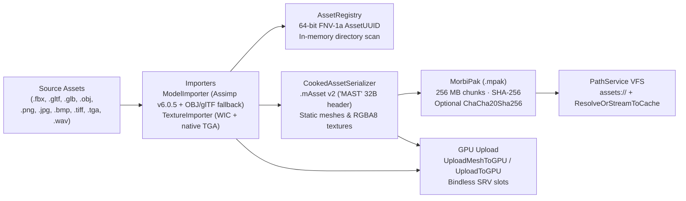

# Asset Pipeline (`Morbi.Asset` · `Morbi.IO`)

**Status:** **In Progress**

---

## 1. Verified Asset Workflow

---

## 2. Verified Components

- **`ModelImporter` (`ModelImporter.cpp`, 1,288 LOC):**
  - Primary backend: Assimp v6.0.5 (`MORBI_HAS_ASSIMP=1`) for `.fbx`, `.gltf`, `.glb`, `.obj`.
  - Built-in fallbacks: text `.obj` parser and minimal `.gltf` JSON parser.
  - Produces 92-byte `StaticMeshVertex` buffers with Gram-Schmidt MikkTSpace tangents, submeshes, materials, skeleton hierarchies, and animation clips.
- **`TextureImporter` (`TextureImporter.cpp`):**
  - Native 24/32-bit `.tga` loader + Windows Imaging Component (WIC) for `.png`, `.jpg`, `.bmp`, `.tiff`, embedded memory textures, and procedural checkerboard generation.
- **`CookedAssetSerializer` (`CookedAssetSerializer.cpp`):**
  - Binary `.mAsset` v2 format (`MAST` magic) for static meshes and RGBA8 textures, plus GPU buffer creation/destruction.
- **`AssetRegistry` (`AssetRegistry.cpp`):**
  - Thread-safe map keyed by deterministic 64-bit FNV-1a `AssetUUID`; supports recursive directory scanning and JSON manifest export.
- **`MorbiPak` (`Engine/Source/IO/src/MorbiPak.cpp`):**
  - Chunked `.mpak` archive writer/reader with SHA-256 verification and optional `ChaCha20Sha256` encryption.

## 3. Known Gaps

- `CookStaticMeshToFile` does **not** serialize `BoneOffsets`, `SkeletonHierarchy`, or `AnimationClip` data yet.
- `AssetRegistry` exports JSON manifests (`SaveToJsonFile`) but has no incremental `LoadFromJsonFile` — projects rescan asset folders on startup.
- `TextureImporter` depends on Windows WIC (`windowscodecs`, `ole32`) for PNG/JPG/BMP/TIFF decoding.
- `MorbiPak` compression currently only implements `PakCompression::None`.
