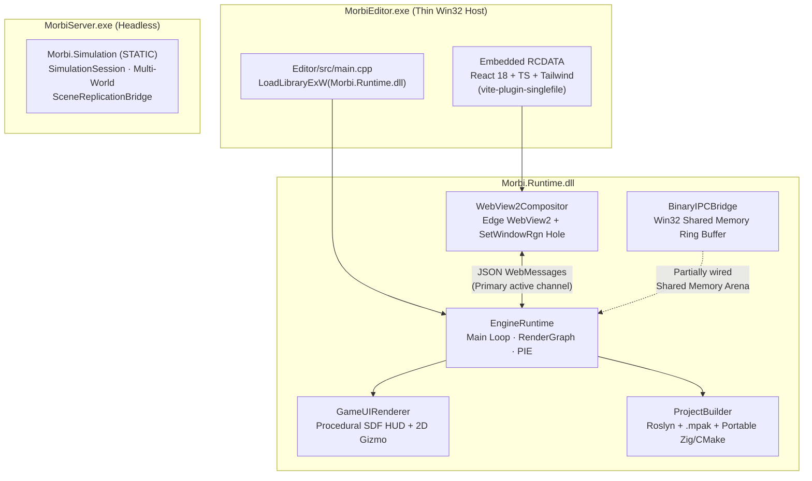

# Editor, Runtime UI & Dedicated Server Architecture

This document covers `Editor/`, `Morbi.UI`, `Morbi.Runtime`, `Morbi.Simulation`, `MorbiServer`, and `ProjectBuilder`.

---

## 1. Editor & Runtime Topology

---

## 2. Editor Thin Host & React 18 Frontend (`Editor/`) — Status: **Implemented**

- **Thin Host (`Editor/src/main.cpp`):** Zero static/import-lib linkage to `Morbi.*`. Resolves `game.morbiproj` and dynamically loads `Morbi.Runtime.dll` via `LoadLibraryExW`, passing `--editor`.
- **Frontend (`Editor/Frontend/`):** React 18.3, TypeScript 5.6 (strict mode), Tailwind CSS 3.4, Vite 5.4 + `vite-plugin-singlefile`. Bundles into a single `dist/index.html` that is compiled directly into `MorbiEditor.exe` via `Editor/src/EmbeddedFrontend.rc` (zero local HTTP server needed).
- **Panels:** `TopBar`, `QuickToolsRail`, `HierarchyPanel`, `ViewportArea`, `AssetBrowserPanel`, `ConsolePanel`, `InspectorPanel`, `MiniMapPanel`, `StatusBar`.
- **Honest Caveat:** Some viewport/status metrics in `App.tsx` (such as `drawCalls`, `triangles`, and `memoryMb`) currently use synthetic/placeholder formulas rather than live GPU counters.

---

## 3. Native UI & Compositing (`Morbi.UI`) — Status: **In Progress**

- **`WebView2Compositor` (`WebView2Compositor.cpp`, 2,416 LOC):** Hosts Edge WebView2 using hand-written `ICoreWebView2*` COM vtables (no WebView2 SDK header dependency). Viewport compositing relies on Win32 **`SetWindowRgn` hole-punching** around `ViewportChildHwnd` and open HTML menus. *(Note: DirectComposition visual objects are created in code, but are not yet bound to an `IDCompositionTarget` or swapchain surface.)*
- **`BinaryIPCBridge` (`BinaryIPCBridge.cpp`, 468 LOC):** Creates named Win32 shared memory (`Local\MorbiEngine_UI_SharedArena`) and implements binary transform/telemetry packet packing; however, live Editor JS↔C++ traffic currently runs primarily over WebView2 JSON WebMessages.
- **`GameUIRenderer` (`GameUIRenderer.cpp`, 577 LOC):** Procedural HLSL SDF renderer for in-game HUD widgets and the Edit Mode 2D screen-space transform gizmo.

---

## 4. Headless Dedicated Server & Standalone Export (`Morbi.Runtime`)

- **`MorbiServer.exe` (`Morbi.Simulation`):** Links only `Core`, `IO`, `Scene`, `Physics`, `Audio`, `Network`, and `Script` — completely stripped of `Platform`, `RHI`, `Render`, and `UI`. Supports multi-world `WorldHost` simulation and authoritative client/server replication (`SceneReplicationBridge`).
- **`ProjectBuilder` (`ProjectBuilder.cpp`):** Compiles C# project scripts via Roslyn, packs chunked encrypted `.mpak` archives, and builds `LauncherTemplate` into a standalone game `.exe` using portable CMake + Zig (`Tools/`).
