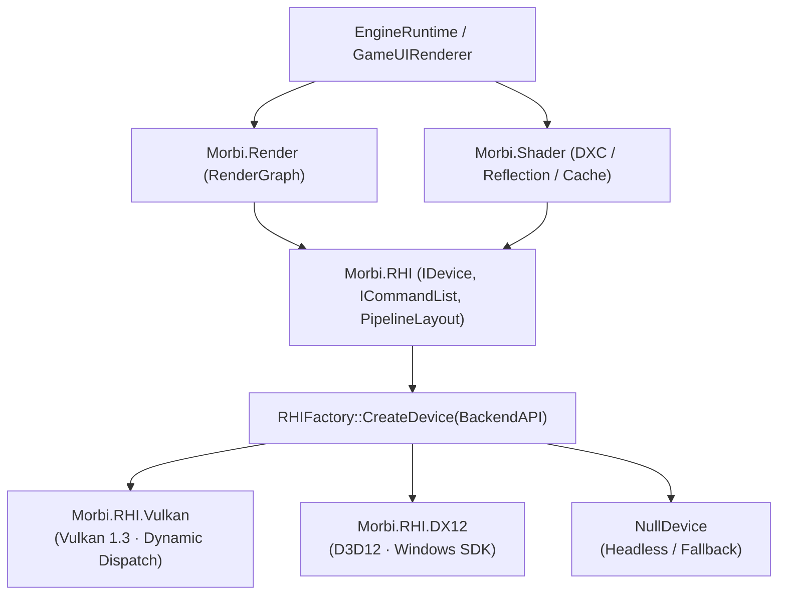
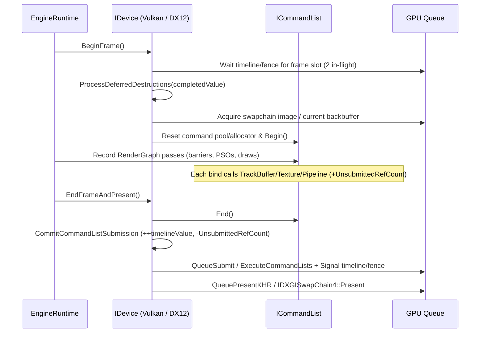

# Graphics & RHI Architecture

This document describes the verified graphics infrastructure across `Morbi.RHI`, `Morbi.RHI.Vulkan`, `Morbi.RHI.DX12`, and `Morbi.Render/src/RHIFactory.cpp`.

---

## 1. Graphics Subsystem Overview

---

## 2. RHI Abstraction (`Morbi.RHI`) — Status: **Implemented (Narrow Surface)**

- **Handles (`RHITypes.hpp`):** Generational handles (`Core::GenerationalHandle<Tag>`) for `BufferHandle`, `TextureHandle`, `PipelineHandle`, `PipelineLayoutHandle` (plus unused `SamplerHandle` and `ShaderHandle` placeholders).
- **`IDevice` (`IDevice.hpp`):** Lifecycle, swapchain/frame control (`BeginFrame`, `EndFrameAndPresent`, `ResizeSwapchain`, `SetVSync`, `WaitIdle`), timeline/deferred destruction (`GetCompletedTimelineValue`, `ProcessCompletedDestructions`), command list creation/submission, buffers, textures, `CreatePipelineLayout`, and graphics/compute pipelines.
- **`ICommandList` (`ICommandList.hpp`):** Recording (`Begin`, `End`, `Discard`), explicit resource tracking (`TrackBuffer`/`Texture`/`Pipeline`/`PipelineLayout`), barriers (`TransitionTexture`, `TransitionBuffer`), dynamic rendering (`BeginRendering`/`EndRendering`), viewport/scissor, `SetPipeline`, `PushConstants`, vertex/index/constant buffer binds, `Draw`/`DrawIndexed`/`Dispatch`, and debug markers.
- **`PipelineLayoutValidator` (`PipelineLayout.cpp`):** Normalizes descriptors, computes FNV-1a canonical hashes, and enforces DX12 64-DWORD root signature limits, Vulkan per-stage & `UpdateAfterBind` limits, 128-byte push constant limits, and reserved Set 0 in `GlobalBindlessHybrid` mode.
- **Current RHI Surface Gaps:** No `BindDescriptorSet` on `ICommandList`, no explicit `IQueue`/`ISwapchain`/`ISampler`, no indirect draw/dispatch, no `CopyBuffer`/`Blit`, and `GraphicsPipelineDesc` lacks configurable vertex input layouts, cull mode, blend factors, and MRT color target arrays.

---

## 3. Vulkan 1.3 Backend (`Morbi.RHI.Vulkan`) — Status: **Implemented**

- **Dynamic Dispatch (`VulkanDispatch.hpp`):** Loads `vulkan-1.dll` via `LoadLibraryA` with `VK_NO_PROTOTYPES` and populates global, instance, and device function tables (zero static link dependency on the Vulkan loader).
- **Required Vulkan 1.3 Features:** `dynamicRendering`, `timelineSemaphore`, `descriptorIndexing`, `VK_KHR_swapchain`. Optional `VK_LAYER_KHRONOS_validation`, `VK_EXT_debug_utils`, and `VK_EXT_validation_features` (`--gpu-gbv`).
- **Custom Slab Allocator (`VulkanMemoryAllocator`):** 32 MB default slabs with sorted/coalesced free-range lists, persistent `vkMapMemory` for host-visible blocks, and excess empty slab reclamation (custom implementation; does not use third-party VMA).
- **Bindless Set 0 (`UPDATE_AFTER_BIND` + `PARTIALLY_BOUND`):**
  - Binding 0: `STORAGE_BUFFER[4096]`
  - Binding 1: `SAMPLED_IMAGE[4096]`
  - Binding 2: `SAMPLER[1]` (default linear wrap)
  - Binding 3: `UNIFORM_BUFFER[256]`
  - Push Constants: 128 bytes (`VK_SHADER_STAGE_ALL`)
- **Known Limitations:** Single graphics queue; hardcoded vertex input layouts for 60 B (static) and 92 B (skinned) strides; `UpdateBufferData`/initial `GpuOnly` buffer data uses host-visible memory rather than staging; `CreateTexture` initial data assumes 4 BPP; `BindConstantBuffer` mutates Set 0 binding 3 during recording when offset/non-bindless. *(Note: The `BeginFrame` `VK_ERROR_OUT_OF_DATE_KHR` fence-reset deadlock was fixed during this audit.)*

---

## 4. DirectX 12 Backend (`Morbi.RHI.DX12`) — Status: **Implemented (Partial Parity)**

- **Device & Diagnostics (`DX12Device.cpp`, `DX12Debug.cpp`):** Uses standard Windows SDK `d3d12`, `dxgi`, `dxguid` (`ID3D12Device5`, `ID3D12GraphicsCommandList6`, `D3D_FEATURE_LEVEL_12_0`). **Does not use the DirectX 12 Agility SDK.** Includes D3D12 Debug Layer, optional GBV (`--gpu-gbv`), `ID3D12InfoQueue1`, `IDXGIDebug1` live-object checks, and forced-on **DRED** (`AutoBreadcrumbs1` + `PageFaultAllocationOutput1`).
- **Descriptor Heaps & Default Root Signature:**
  - Shader-visible CBV/SRV/UAV heap (8,448 slots: `[0..4095]` buffer SRVs `t0 space0`, `[4096..8191]` texture SRVs `t0 space1`, `[8192..8447]` CBV parity slots).
  - Default Root Signature V1.0: Slot 0 = 32-DWORD Root Constants (`b0, space0`), Slot 1 = SRV Descriptor Table (`t0 space0` + `t0 space1`), Slot 2 = Root CBV (`b1, space0`), Static Sampler (`s0, space0`).
- **Memory Allocation:** Individual `CreateCommittedResource` calls for standard resources; one 32 MB `ID3D12Heap` exists only for explicit `AliasingPoolOffset` paths.

---

## 5. Honest Vulkan vs. DirectX 12 Parity Matrix

| Capability | Vulkan 1.3 (`RHI.Vulkan`) | DirectX 12 (`RHI.DX12`) |
|---|---|---|
| Dynamic Rendering / Render Targets | Vulkan 1.3 `vkCmdBeginRendering` | Legacy `OMSetRenderTargets` + `Clear*View` |
| Barriers | Legacy `vkCmdPipelineBarrier` (caller-tracked) | Legacy `ResourceBarrier` (internal state tracking) |
| Memory Allocation | Custom 32 MB slab sub-allocator | `CreateCommittedResource` per resource |
| Bindless SRVs (Buffers & Textures) | Set 0 (`4096` + `4096`) | Shader-visible heap (`4096` + `4096`) |
| `BindConstantBuffer` | Mutates Set 0 binding 3 (ignores slot) | Proper per-draw `SetGraphicsRootConstantBufferView` |
| Custom `PipelineLayout` | Cached `VkPipelineLayout` + sets | Cached serialized `ID3D12RootSignature` |
| Deferred Destruction & Sync | Timeline semaphore + `UnsubmittedRefCount` | `ID3D12Fence` + `UnsubmittedRefCount` |
| Debug Markers | `vkCmdBeginDebugUtilsLabelEXT` | Empty no-op |
| Crash Forensics | Validation layers + debug messenger | Debug layer + **DRED** breadcrumbs/page-faults |
| Frames in Flight | 2 | 2 |

---

## 6. Frame Execution & Command Submission Flow

