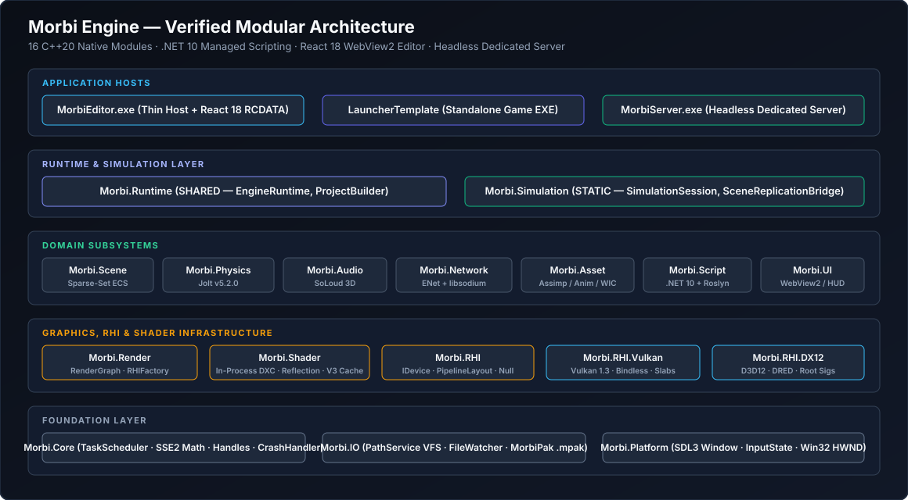
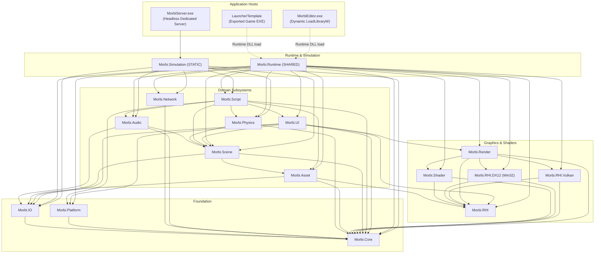
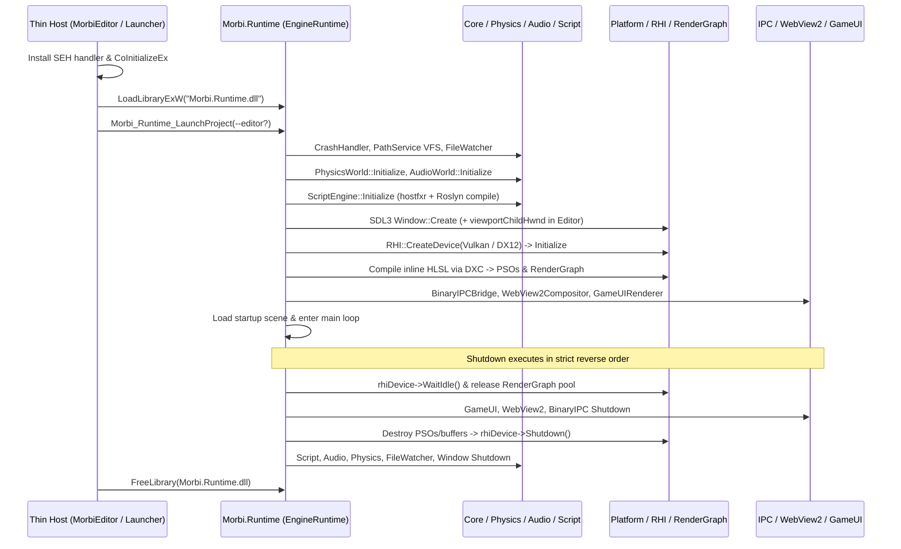

# Morbi Engine — Architecture Overview

Morbi Engine is organized as **16 modular C++20 libraries**, a **`.NET 10` managed scripting bridge (`Managed/Morbi.Engine`)**, a **thin native Editor host (`MorbiEditor.exe`)** embedding a React 18 + TypeScript frontend, a **standalone game launcher template (`LauncherTemplate`)**, and a **headless dedicated server (`MorbiServer.exe`)**.

---

## 1. Verified CMake Module Dependency Graph

The graph below reflects actual `target_link_libraries` dependencies in `CMakeLists.txt` and `Engine/Source/*/CMakeLists.txt`:

---

## 2. Engine Lifecycle (Startup & Reverse-Order Shutdown)

### Editor & Standalone Game Lifecycle (`EngineRuntime::RunProject`)

### Headless Dedicated Server Lifecycle (`MorbiServer.exe`)

`MorbiServer` links **only** `Morbi::Simulation` (zero `Platform`, `RHI`, `Render`, or `UI` dependencies). `ServerMain.cpp` installs signal handlers, initializes `SimulationSession` with multi-world `WorldHost` instances (each owning a `Scene`, `PhysicsWorld`, and `SceneReplicationBridge`), runs `RunServerLoop`, and shuts down cleanly.

---

## 3. Known Architectural Debt (Tracked Honestly)

- **Monolithic `EngineRuntime.cpp` (~5,300 LOC):** Currently houses inline HLSL shader strings, editor command routing, smoke-test harness, rendering passes, and PIE management in a single file.
- **Duplicate Source Compilation in `Runtime/CMakeLists.txt`:** `SimulationSession.cpp` and `SceneReplicationBridge.cpp` are compiled into both `Morbi.Simulation` (STATIC) and `Morbi.Runtime` (SHARED).
- **Windows-Centric Platform Layer:** `RHI.DX12`, `WebView2Compositor`, `FileWatcher` (`ReadDirectoryChangesW`), `TextureImporter` (WIC), and `VulkanDevice` (`LoadLibraryA("vulkan-1.dll")`) currently assume Win32.
