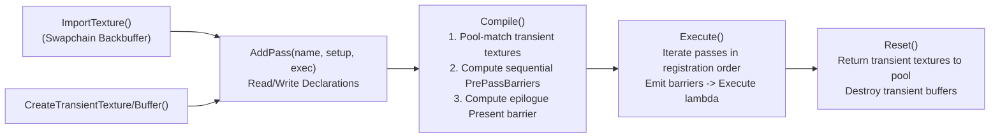
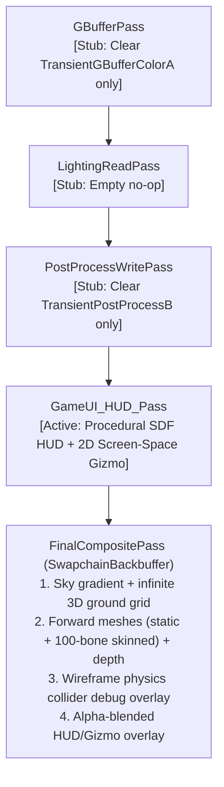

# Render Pipeline & Render Graph

This document covers `Morbi.Render` (`RenderGraph`) and the active rendering passes implemented in `Engine/Source/Runtime/src/EngineRuntime.cpp` and `Engine/Source/UI/src/GameUIRenderer.cpp`.

---

## 1. Render Graph (`Morbi.Render`) — Status: **In Progress**

`RenderGraph` (`RenderGraph.hpp` / `RenderGraph.cpp`, 432 LOC) provides pass registration, resource declaration, sequential barrier generation, and frame-to-frame transient texture pooling.

### Verified Limitations of `RenderGraph`
1. **No DAG / Topological Sort / Dead-Pass Culling:** Passes execute strictly in registration order (`RenderGraph.cpp:367`); unused passes are not culled.
2. **Transient Memory Aliasing Is Stats-Only:** `Compile()` computes aliasing metrics, then explicitly resets `tex.Desc.AliasingPoolOffset = ~0ULL` (`RenderGraph.cpp:241`) before calling `CreateTexture`, so GPU memory is not physically aliased yet.
3. **Transient Buffers Are Not Pooled:** Allocated in `Compile()` and destroyed every `Reset()`.
4. **Sequential Barriers:** Emits one barrier call per resource transition and skips `UnorderedAccess -> UnorderedAccess` barriers.

---

## 2. Active Scene Render Passes (`EngineRuntime.cpp`)

The current frame pipeline registers five RenderGraph passes, though three are placeholder stubs:

---

## 3. Honest Rendering Feature Maturity

| Feature | Maturity | Verified Implementation Details |
|---|---|---|
| Forward Mesh Rendering | **Implemented** | Indexed `GPUMeshBuffers`, multi-submesh support, `D32_Float` depth buffer, bindless Albedo/Normal/Specular textures. |
| GPU Skeletal Skinning | **Implemented** | Up to 100 `Mat4` bone matrices per `AnimatorComponent` uploaded via bindless UBO (Vulkan) / Root CBV (DX12). |
| Physics Debug Wireframe | **Implemented** | `physicsDebugPSO` draws collider bounds in `FinalCompositePass`. |
| Materials & Lighting | **Experimental** | `kScenePbrMeshHlslShader` is currently hardcoded **Blinn-Phong** with 2 fixed directional lights and fixed view vector `V=(0,0,-1)`. `Scene::LightComponent`, `BaseColorFactor`, and `Metallic` are not yet wired to the shader. |
| Camera Projection | **In Progress** | Orbit/fly Editor camera and Game Mode camera transform work; `CameraComponent` FOV/near/far/ortho fields are currently overridden by hardcoded `45° / 0.1 / 100.0` perspective. |
| Transform Gizmo & HUD | **In Progress** | Rendered as a 2D screen-space procedural SDF shader (`kGameUIProceduralHlslShader`) composited over the viewport; no GPU font rasterizer or 3D depth-tested gizmo geometry yet. |
| Deferred GBuffer / Shadows / IBL / Post-FX | **Planned** | Placeholder RenderGraph passes exist; no shadow maps, cubemaps/IBL, bloom, tonemapping, or AA passes are implemented yet. |
