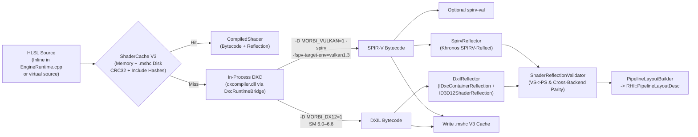

# Shader Pipeline (`Morbi.Shader`)

`Morbi.Shader` is one of the most mature graphics subsystems in Morbi Engine. It provides **in-process DXC dual-target compilation**, **persistent CRC32 disk caching with transitive `#include` tracking**, **binary reflection for both SPIR-V and DXIL**, **cross-backend validation**, and **`PipelineLayoutBuilder`**.

---

## 1. Dual-Target Compilation & Reflection Flow

---

## 2. Verified Implementation Details

- **In-Process DXC (`ShaderCompiler.cpp`, `DxcRuntimeBridge.hpp`):** Dynamically loads `dxcompiler.dll` (or `libdxcompiler.so` on Linux) with pooled worker contexts (`IDxcUtils` + `IDxcCompiler3`). Does **not** use `glslangValidator`.
- **Custom Include Handler (`MorbiDxcIncludeHandler`):** Detects include cycles (`kMaxIncludeLoadsPerFile = 32`) and hashes every transitive `#include` file for cache invalidation.
- **ShaderCache V3 (`ShaderCache.cpp`):** Two-tier cache (thread-safe memory map + `.mshc` binary files with 40-byte `'MSHC'` header, compiler version hash, and CRC32 check). Recovers gracefully from corrupt or stale files.
- **Reflection & Layout Synthesis:**
  - `SpirvReflector.cpp` parses SPIR-V binaries via vendored Khronos `SPIRV-Reflect`.
  - `DxilReflector.cpp` parses DXIL containers via `IDxcContainerReflection` + `ID3D12ShaderReflection`.
  - `ShaderReflectionValidator.cpp` checks `StrictOneToOne` and `MorbiBindless` cross-backend policies.
  - `PipelineLayoutBuilder.cpp` produces canonical `RHI::PipelineLayoutDesc` objects.

## 3. Current Integration Gaps

- Active engine shaders (`kUnifiedHlslShader`, `kScenePbrMeshHlslShader`, `kGameUIProceduralHlslShader`, `kGameUIOverlayHlslShader`) are currently embedded as C++ raw string literals in `EngineRuntime.cpp` rather than standalone `.hlsl` files.
- `EngineRuntime.cpp` currently binds the default global bindless layout for its 5 PSOs rather than calling `PipelineLayoutBuilder` + `IDevice::CreatePipelineLayout`.
